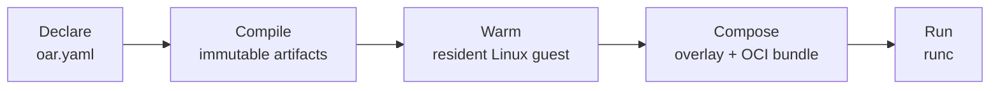

<div align="center">

# open-agent-runtime

**Composable, reproducible Linux runtimes for AI agents and developer tools: declare once, start in milliseconds, anywhere.**

[](https://github.com/AkaraChen/open-agent-runtime/actions/workflows/ci.yml)
[](https://pkg.go.dev/github.com/AkaraChen/open-agent-runtime)


[](LICENSE)

English | [简体中文](README.zh-CN.md)

</div>

---

## What is open-agent-runtime?

Agents and the tools they drive need real Linux environments: a language runtime or two, git, a
handful of CLIs, and your own binaries. Building those environments as container images is slow,
images drift, and every change means rebuilding and redistributing gigabytes.

**open-agent-runtime** (`oar`) treats an environment as a *composition* rather than an image. You
list what you need. `oar` compiles every piece ahead of time into immutable, content-addressed
artifacts, then assembles them into a running container in milliseconds. On macOS and Windows it
runs inside a lightweight Linux VM that stays resident.

```yaml
runtime:
  base: debian:trixie-slim

components:
  - nix:nodejs_22
  - nix:python313
  - nix:git
  - binary:my-agent

process:
  command: ["/opt/my-agent"]
```

```console
$ oar build     # compile once
$ oar run       # start in ~40 ms
$ oar reload    # switch to a new environment with no downtime
```

## Why open-agent-runtime?

- **Fast where it matters.** All resolution, downloading and packaging happens at build time.
  Starting or switching an environment only mounts cached layers and calls `runc`: about 40 ms end
  to end on Linux (see [Performance](#performance)).
- **Reproducible by construction.** Base images are pinned by digest and packages by commit. The same
  set of components always produces the same bundle digest and the same environment, regardless of
  the order you list them in.
- **Composable, not monolithic.** Mix a distro base, any of the 100,000+ packages in nixpkgs, and your
  own binaries, directories or inline files. Conflicts are reported, never silently resolved.
- **No Nix installation.** A Nix evaluator ([iets](https://github.com/numtide/iets)) is built into
  the `oar` binary; packages are resolved and fetched from the binary cache without `nix` or Docker
  on the machine.
- **Ship artifacts, not images.** Compiled environments are plain content-addressed files. Distribute
  them to fleets, deduplicate across versions, and roll out new environments without build tools on
  the target.
- **Safe rollouts.** Readiness checks and atomic reloads: a new environment that fails to come up
  never replaces the one that works.
- **One workflow on every machine.** The same CLI and the same environments on Linux servers, macOS
  laptops and CI.

## How it works



1. **Compile.** The builder resolves the base image, a pinned set of Nix packages with their full
   runtime closure, and your custom files into verified, content-addressed artifacts.
2. **Warm.** Artifacts are loaded once into the guest's cache. Later environments only transfer
   what is new.
3. **Compose and run.** Each start mounts a layered view of cached artifacts and launches it as an
   OCI container.

Read the [architecture guide](docs/architecture.md) for the full design.

## Features

| | |
|---|---|
| **Declarative environments** | Base image, Nix packages, binaries, directories and inline files in one YAML file |
| **Pinned and verified** | Digest-pinned bases, commit-pinned nixpkgs (per package if needed), signature-checked downloads |
| **Self-contained builds** | Built-in Nix evaluator; `oar nix-eval` shows what a build resolves |
| **Multi-architecture** | Artifacts for `linux/amd64` and `linux/arm64` from any build host |
| **Resident guest** | A minimal Linux VM boots once and serves every container: Virtualization.framework on macOS, KVM on Linux |
| **Zero-downtime reloads** | `overlap` and `replace` strategies, readiness checks, automatic rollback |
| **Offline distribution** | Start and switch compiled environments by digest: no config, compilers or network needed |
| **Isolated environments** | Each container sees only its own `/nix/store` closure, read-only |

## Performance

Measured on GitHub-hosted CI runners with `hack/bench` (4 vCPUs on Linux; the guest VM gets 2 vCPUs
and 4 GiB), on the example environment: Debian, Node.js, Python, git and a custom binary, 120 Nix
store paths, 553 MiB. Medians. Full results, including p99 and every intermediate step, are in
[docs/benchmarks/15-main](docs/benchmarks/15-main/README.md).

| | Linux, native | Linux, KVM | macOS, VZ ¹ | macOS, QEMU ² |
|---|---|---|---|---|
| Start a warm environment (`oar run`) | 37 ms | 36 ms | 213 ms | 474 ms |
| Switch versions through the ingress proxy, 0 dropped requests | 61 ms | 59 ms | 444 ms | 592 ms |
| Switch to a pre-created instance | 38 ms | 37 ms | 272 ms | 285 ms |
| Switch a slow-starting app to its hot standby | 13 ms | 13 ms | 87 ms | 62 ms |
| Restore an app from its snapshot | 60 ms | 47 ms | 352 ms | — |
| Reload to an environment with one new package (upload included) | 49 ms | 49 ms | 746 ms | 587 ms |
| 10 environments started at once, each | 167 ms | 164 ms | 1.4 s | 2.5 s |
| Boot the resident VM | — | 204 ms | 10.2 s | 2.7 s |
| Warm the whole environment into the VM (553 MiB) | 1.4 s | 1.4 s | 44 s | 41 s |
| Build from scratch (nixpkgs source cached) | 2.1 s | 1.5 s | 8.8 s | 4.7 s |

¹ An Intel Mac runner, which runs the VM under nested virtualization; most of the boot time is VZ
loading the kernel there. ² Apple Silicon with no hardware virtualization on CI, so the arm64 guest
runs under TCG emulation. Real Macs are expected to be much faster in both columns; they have not
been measured yet.

## Getting started

> open-agent-runtime is in **alpha**. Interfaces may change.

```console
# build the CLI and the guest image
$ hack/build.sh
$ guest/build.sh amd64          # or arm64

# run the example environment
$ cd examples/agent-runtime
$ ../../bin/oar run
$ ../../bin/oar exec -- node --version
v22.23.3
$ ../../bin/oar stop --rm
```

See [platforms](docs/platforms.md) for host requirements and supported backends.

## Documentation

| Guide | |
|---|---|
| [Architecture](docs/architecture.md) | design, components, data flow, diagrams |
| [Configuration](docs/configuration.md) | the `oar.yaml` reference |
| [Operations](docs/operations.md) | switching environments, distributing caches, reload strategies |
| [Platforms](docs/platforms.md) | backends, guest image, macOS notes |
| [Development](docs/development.md) | building, testing, CI |
| [VM runtime landscape](docs/research/vm-runtime-landscape.zh-CN.md) | survey of VM/sandbox runtimes and roadmap (Chinese) |

## Platform support

| Host | Status |
|---|---|
| Linux (native or KVM) | ✅ supported |
| macOS (Virtualization.framework, QEMU fallback) | ✅ supported |
| Windows (WSL2) | 🧪 experimental |
| Android | 🗺️ planned |

## Roadmap

- Port forwarding from VM guests to the host
- Remote artifact stores and incremental sync
- Windows (WSL2) support
- Android support

## Contributing

Contributions are welcome. Start with the [development guide](docs/development.md). Before you
submit a change, run `go test ./...` and the acceptance suite (`hack/e2e.sh`) on at least one
backend.

## License

open-agent-runtime is licensed under the [MIT License](LICENSE).
