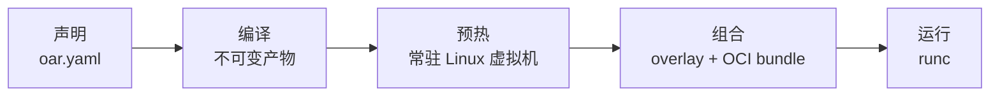

<div align="center">

# open-agent-runtime

**为 AI Agent 和开发者工具打造的可组合、可复现的 Linux 运行时：声明一次，毫秒级启动，处处可用。**

[](https://github.com/AkaraChen/open-agent-runtime/actions/workflows/ci.yml)
[](https://pkg.go.dev/github.com/AkaraChen/open-agent-runtime)


[](LICENSE)

[English](README.md) | 简体中文

</div>

---

## open-agent-runtime 是什么？

Agent 和它要驱动的工具，需要的是一个真正的 Linux 环境：一两种语言运行时、git、若干命令行工具，再加上你自己的程序。
把这些打包成容器镜像，构建慢，环境容易漂移，而且改一点东西就得重新构建、重新分发几个 GB 的镜像。

**open-agent-runtime**（命令行工具 `oar`）不把环境看作一个镜像，而是看作一组可以自由**组合**的部件。你只需要列出需要什么，
`oar` 会提前把每个部件编译成不可变的、按内容寻址的产物，启动时在毫秒级把它们组装成一个运行中的容器。
在 macOS 和 Windows 上，容器运行在一个常驻的轻量 Linux 虚拟机里。

```yaml
runtime:
  base: debian:trixie-slim

components:
  - nix:nodejs_22
  - nix:python313
  - nix:git
  - binary:my-agent

process:
  command: ["/opt/my-agent"]
```

```console
$ oar build     # 编译一次
$ oar run       # 约 40 毫秒启动
$ oar reload    # 切换到新环境，不停机
```

## 为什么选择 open-agent-runtime？

- **快在关键路径上。** 依赖解析、下载、打包全部在构建阶段完成。启动或切换环境时只是挂载已缓存的层，然后调用 `runc`，
  在 Linux 上端到端约 40 毫秒（见[性能](#性能)）。
- **天然可复现。** 基础镜像按 digest 锁定，软件包按 commit 锁定。同一组部件永远得到同一个 bundle digest 和同一个运行环境，
  与书写顺序无关。
- **按需组合，而非一整块镜像。** 发行版基础镜像、nixpkgs 中超过 10 万个软件包、你自己的二进制、目录或直接写在配置里的文件，
  可以任意搭配。发生冲突时会明确报错，绝不悄悄覆盖。
- **不需要安装 Nix。** `oar` 二进制内置了 Nix 求值器（[iets](https://github.com/numtide/iets)），
  解析软件包、从二进制缓存下载，机器上不需要 `nix` 也不需要 Docker。
- **分发产物，而不是镜像。** 编译好的环境就是一堆按内容寻址的普通文件，可以分发给整个集群，不同版本之间自动去重，
  目标机器上不需要任何构建工具就能上线新环境。
- **安全上线。** 支持就绪检查和原子切换：新环境没能正常起来，就不会替换掉正在工作的旧环境。
- **所有机器一套用法。** Linux 服务器、macOS 笔记本和 CI 上，是同一个命令行、同一份环境。

## 工作原理



1. **编译**：构建器解析基础镜像、锁定版本的 Nix 软件包及其完整运行时依赖、以及你的自定义文件，
   全部转换为经过校验、按内容寻址的产物。
2. **预热**：产物只需加载一次，进入虚拟机里的缓存；之后的新环境只传输新增的部分。
3. **组合并运行**：每次启动只是把缓存的产物挂载成一个分层视图，作为 OCI 容器启动。

完整设计见[架构文档](docs/architecture.md)。

## 功能特性

| | |
|---|---|
| **声明式环境** | 基础镜像、Nix 软件包、二进制、目录、内联文件，全部写在一个 YAML 文件里 |
| **锁定并校验** | 基础镜像锁 digest，nixpkgs 锁 commit（可以细到单个包），下载内容校验签名 |
| **自给自足的构建** | 内置 Nix 求值器；`oar nix-eval` 直接展示构建解析出的结果 |
| **多架构** | 在任意构建机上产出 `linux/amd64` 和 `linux/arm64` 产物 |
| **常驻虚拟机** | 极简 Linux 虚拟机只启动一次，之后服务所有容器：macOS 用 Virtualization.framework，Linux 用 KVM |
| **不停机切换** | `overlap` / `replace` 两种切换策略，配合就绪检查与自动回滚 |
| **离线分发** | 按 digest 启动、切换已编译的环境，无需配置文件、编译器或网络 |
| **环境隔离** | 每个容器只能看到自己依赖的 `/nix/store` 路径，且全部只读 |

## 性能

数据来自 GitHub 托管的 CI runner 上的 `hack/bench`（Linux 上 4 个 vCPU；guest 虚拟机分到 2 个 vCPU、4 GiB），
测的是示例环境：Debian、Node.js、Python、git 加一个自定义二进制，共 120 个 Nix store path、553 MiB。表中是中位数。
完整结果（含 p99 和每一步的拆分）见 [docs/benchmarks/15-main](docs/benchmarks/15-main/README.md)。

| | Linux，native | Linux，KVM | macOS，VZ ¹ | macOS，QEMU ² |
|---|---|---|---|---|
| 启动已预热的环境（`oar run`） | 37 ms | 36 ms | 213 ms | 474 ms |
| 经入口代理切换版本，0 个请求失败 | 61 ms | 59 ms | 444 ms | 592 ms |
| 切换到预创建的实例 | 38 ms | 37 ms | 272 ms | 285 ms |
| 慢启动应用切换到热备 | 13 ms | 13 ms | 87 ms | 62 ms |
| 从快照恢复应用 | 60 ms | 47 ms | 352 ms | — |
| reload 到多一个新包的环境（含上传） | 49 ms | 49 ms | 746 ms | 587 ms |
| 同时启动 10 个环境，单个耗时 | 167 ms | 164 ms | 1.4 s | 2.5 s |
| 启动常驻虚拟机 | — | 204 ms | 10.2 s | 2.7 s |
| 把整个环境预热进虚拟机（553 MiB） | 1.4 s | 1.4 s | 44 s | 41 s |
| 从零构建（nixpkgs 源码已缓存） | 2.1 s | 1.5 s | 8.8 s | 4.7 s |

¹ Intel Mac runner，虚拟机跑在嵌套虚拟化里，启动时间大部分花在 VZ 加载内核上。
² CI 上的 Apple Silicon 没有硬件虚拟化，arm64 guest 用 TCG 模拟运行。
两列在真机上预计都会快很多，但还没有实测。

## 快速开始

> open-agent-runtime 目前处于 **alpha** 阶段，接口可能发生变化。

```console
# 构建命令行工具和虚拟机镜像
$ hack/build.sh
$ guest/build.sh amd64          # 或 arm64

# 运行示例环境
$ cd examples/agent-runtime
$ ../../bin/oar run
$ ../../bin/oar exec -- node --version
v22.23.3
$ ../../bin/oar stop --rm
```

宿主机要求和支持的后端见[平台文档](docs/platforms.md)。

## 文档

| 文档 | |
|---|---|
| [架构](docs/architecture.md) | 设计、组件、数据流与架构图 |
| [配置](docs/configuration.md) | `oar.yaml` 配置参考 |
| [运维](docs/operations.md) | 切换环境、分发缓存、切换策略 |
| [平台](docs/platforms.md) | 后端、虚拟机镜像、macOS 说明 |
| [开发](docs/development.md) | 构建、测试、CI |
| [VM 运行时调研](docs/research/vm-runtime-landscape.zh-CN.md) | 业界 VM/沙箱方案、优化精要与 oar 路线图（中文） |

> 以上文档目前为英文。

## 平台支持

| 宿主机 | 状态 |
|---|---|
| Linux（原生或 KVM） | ✅ 已支持 |
| macOS（Virtualization.framework，QEMU 兜底） | ✅ 已支持 |
| Windows（WSL2） | 🧪 实验性 |
| Android | 🗺️ 规划中 |

## 路线图

- 虚拟机内容器端口转发到宿主机
- 远程产物仓库与增量同步
- Windows（WSL2）支持
- Android 支持

## 参与贡献

欢迎贡献！请先阅读[开发指南](docs/development.md)。提交改动前，请运行 `go test ./...`，并至少在一个后端上跑一遍验收测试
（`hack/e2e.sh`）。

## 许可证

open-agent-runtime 基于 [MIT 许可证](LICENSE)发布。
