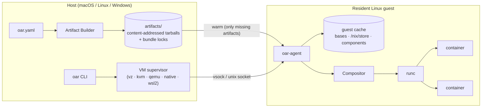
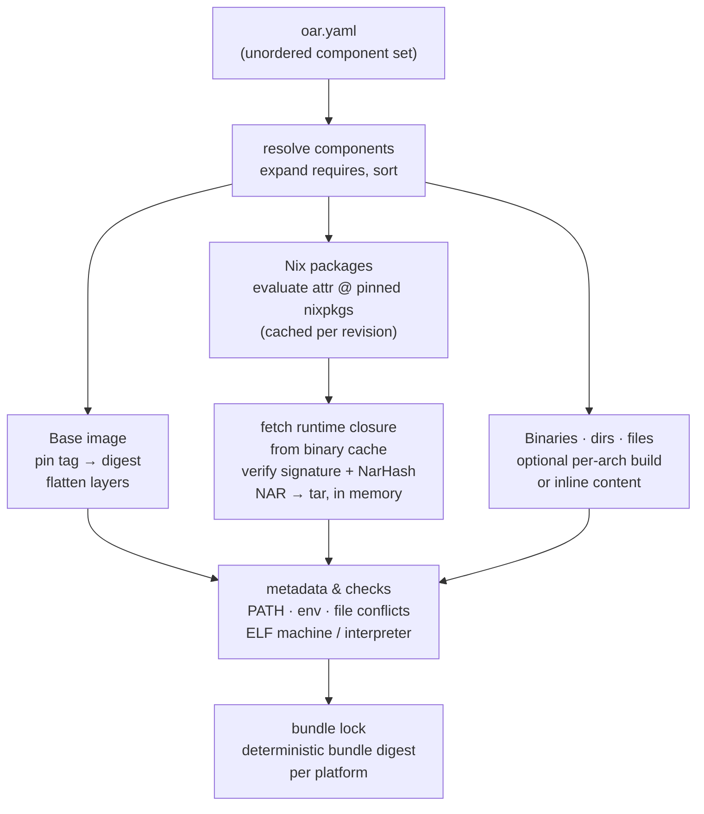
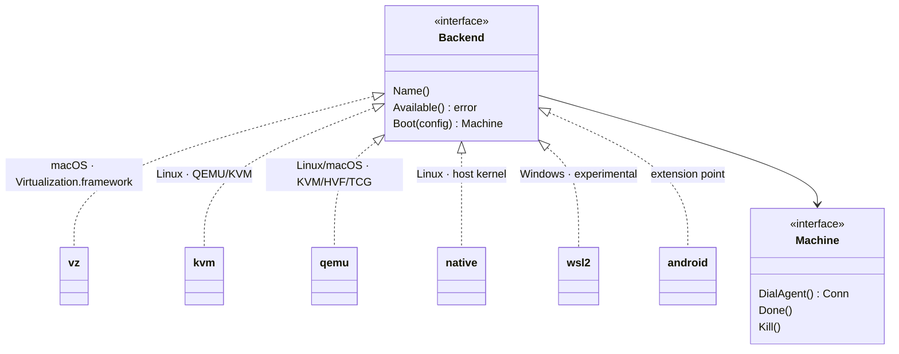
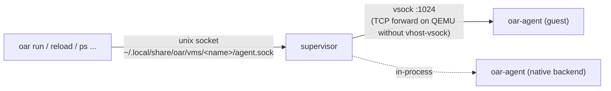
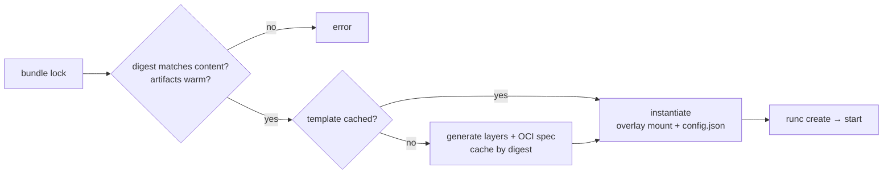
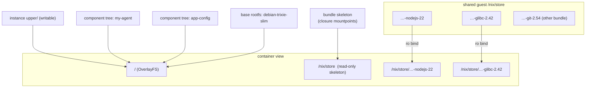
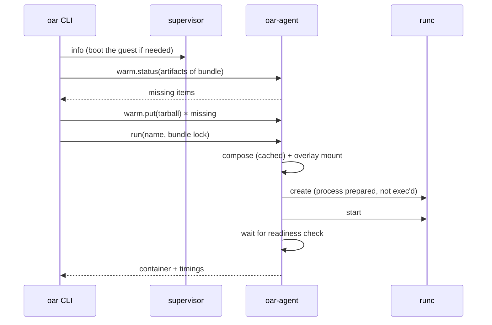
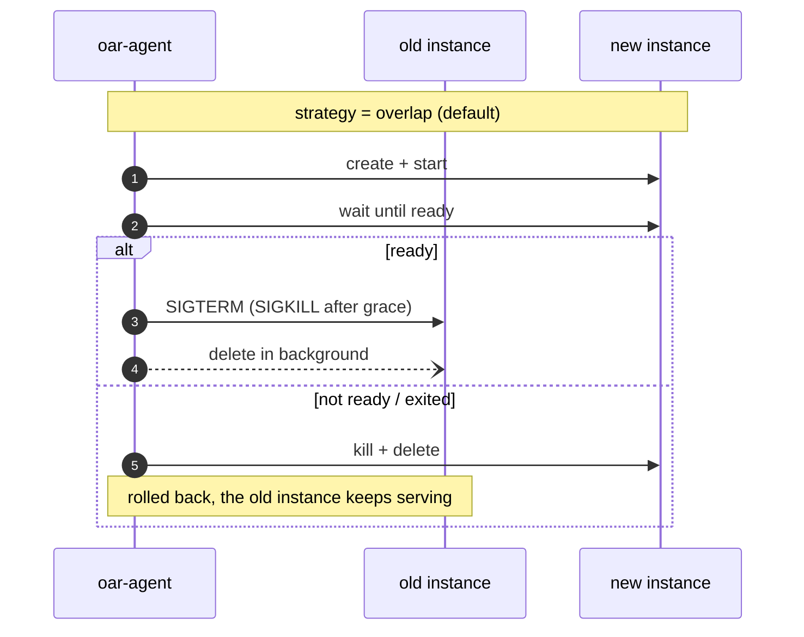
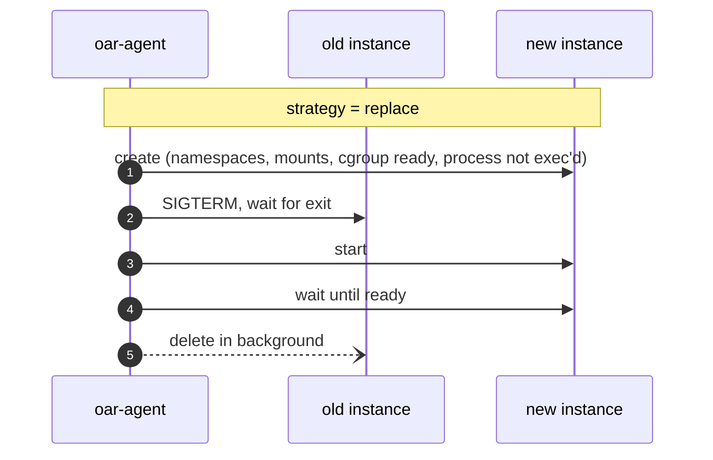

# Architecture

open-agent-runtime (`oar`) turns a declarative description of a Linux environment into a running
container in three stages. Each stage has one job and a clear boundary:

| Stage | Runs | Responsibility | Cost |
|---|---|---|---|
| **Artifact Builder** | on the build host, once per change | resolve, download and pre-compile everything into immutable, content-addressed artifacts | seconds to minutes |
| **Guest Runtime** | resident, per host | a minimal Linux guest that holds the artifact cache and runs containers | boot once (≈1 s on KVM) |
| **Compositor** | in the guest, per start or reload | assemble a bundle from cached artifacts and hand it to `runc` | milliseconds |

The design rule is simple: **anything slow happens in the builder; the hot path only mounts and
starts things.**



## 1. Artifact Builder

The builder runs on the developer machine or in CI. It needs network access and, for Nix
evaluation only, either `nix-instantiate` or Docker. Its output is a directory of immutable artifacts
plus a lock file. Both can be copied anywhere.



The builder produces:

- **Base rootfs.** The OCI base image (Debian slim by default) is pinned by digest, its layers
  flattened (whiteouts applied), and written as a single `rootfs.tar`.
- **Nix closure.** Each package is evaluated once at a pinned nixpkgs commit. Packages may pin their
  own commit with `nix:attr@<rev>`. The full runtime closure is fetched from the binary cache, with
  every narinfo's ed25519 signature and NarHash verified. NARs are converted to tarballs in memory,
  never extracted on the host, so Linux store paths can be prepared on case-insensitive macOS
  filesystems. Each store path becomes its own tarball, which gives deduplication across bundles for
  free.
- **Components.** Custom binaries, directory trees and files (from disk or inline in the config)
  are packed into deterministic tarballs: uid 0 and a fixed mtime, keyed by content hash.
- **Metadata.** Dependency closure, entry point, PATH, environment, file conflicts and ABI
  constraints are all computed here, so nothing has to be decided at start time.

Artifacts are built separately for `linux/amd64` and `linux/arm64`.

### Artifact layout

```text
artifacts/
├── bases/<image>/<platform>/        rootfs.tar + manifest (entries, digest)
├── store/nix/store/<hash-name>.tar  one tarball per store path (+ .json metadata)
├── components/<name>/<platform>/    tree.tar + manifest (files, ELF info)
└── manifests/
    ├── bundle.lock.json             latest build of the default config
    ├── bundles/<digest>.json        every compiled bundle, immutable
    ├── configs/<config-hash>.json   config content → bundle digest per platform
    └── nix-eval.json                evaluation cache (revision, system, attr → outputs)
```

## 2. Guest Runtime

Containers always run on a Linux kernel. On macOS and Windows that kernel lives in a small,
**resident** virtual machine. On Linux it can be the host kernel itself.

### The guest image

| Piece | Contents |
|---|---|
| Kernel | Linux 6.12 LTS, with everything the runtime needs built in (virtio, vsock, ext4, overlayfs, cgroup v2), and no modules |
| Initramfs | `oar-agent` as `/init`, a static `runc`, `mkfs.ext4`, and a busybox userland |
| Data disk | sparse ext4 image, formatted on first boot, mounted at `/var/lib/oar` |

`oar-agent` runs as PID 1 to initialise the system and reap orphans. It then supervises a second
copy of itself that serves the control API. The guest has no package manager and installs nothing:
dependency management happens entirely in the builder.

### Backends

All backends implement one small interface: boot a machine, dial its agent, and stop it.



A host-side **supervisor** process boots the machine, keeps it running, and exposes the guest agent
on a local unix socket. Every CLI command talks to that socket, whatever the backend.



### Control protocol

Each request uses its own stream: a JSON header line, optionally followed by a raw body. Responses
mirror this, with streaming bodies for logs. Artifact tarballs travel as request bodies, so the same
protocol works over vsock, unix sockets and TCP, with no shared filesystem.

| Operation | Purpose |
|---|---|
| `info` | agent version, protocol version, kernel, architecture |
| `warm.status` / `warm.put` | find missing artifacts; upload one; the agent verifies its SHA-256 while extracting, then publishes it atomically |
| `compose` | build the bundle template (cached) and report its digest |
| `run` / `reload` | compose, instantiate and start; reload switches instances |
| `stop` / `delete` / `list` / `state` / `logs` / `exec` | container lifecycle |
| `shutdown` | stop all containers and power off the guest |

The CLI and agent check a protocol version, so a CLI refuses to drive an outdated guest image.

### Guest cache layout

```text
/var/lib/oar/
├── bases/<sha>/rootfs/            extracted base root filesystems
├── store/nix/store/<hash-name>/   shared immutable Nix store (all warmed store paths)
├── components/<sha>/tree/         extracted component trees
├── bundles/<digest>/bundle.json   composed bundle templates (layers + OCI spec)
├── bundles/<digest>/store/        /nix/store skeleton: one empty mountpoint per closure path
└── instances/<id>/                per-container: rootfs (overlay mount), upper/, work/,
                                   config.json, console.log
```

## 3. Compositor

The compositor turns a bundle lock and a warm cache into a runnable OCI bundle. It is the only stage
on the start path, so it is deliberately boring. It **never** evaluates Nix, touches the network,
installs packages, or copies file contents.



The container's root filesystem is a mounted view, not a copied image:



Component layers are ordered by content hash, not by configuration order. This is safe because
conflicts were already rejected by the builder.

The guest keeps one shared, deduplicated `/nix/store`, but each container sees **only its own
closure**. A per-bundle skeleton of empty mountpoints is bound read-only at `/nix/store`, and each
closure path is bound read-only onto its mountpoint. Store paths warmed for other bundles stay
invisible, and nothing under `/nix/store` is writable. For a 120-path closure this adds about 12 ms
to `runc create`.

### Starting a container



### Reloading without downtime

`reload` replaces the running instance with one from another bundle. Two strategies trade overlap
for port exclusivity:





- **overlap** has no gap. If the service listens on a port, it needs `SO_REUSEPORT` so that both
  instances can bind it during the handover.
- **replace** keeps ports exclusive. The gap is the old process's exit time plus the new process's
  startup, typically tens of milliseconds.

See [operations.md](operations.md) for measurements.

## Determinism

The same set of components always produces the same bundle digest and the same container
environment:

- Components are an **unordered set**: `requires` is expanded transitively, duplicates are removed,
  and everything is sorted.
- The **bundle digest** is a SHA-256 over a canonical description of everything the container can
  observe: base digest, store paths with their NarHash, component content hashes, process, and
  environment.
- **Conflicts are errors, never "last one wins".** The builder rejects:
  - a file provided by two components;
  - a base file replaced without `override: true`;
  - a component path that would shadow a base symlink;
  - the same binary provided by two Nix packages;
  - the same environment variable set to different values;
  - an ELF binary built for the wrong machine, or missing its interpreter.
- **PATH order is fixed**: Nix packages sorted by attribute, then component entries, then the base
  PATH.

## Security notes

- **Signatures.** Binary cache downloads are only accepted with a valid signature from a trusted
  key (`cache.nixos.org` by default), and a matching NarHash.
- **Integrity.** Every artifact is verified against its content hash while it is extracted in the
  guest. Bundle locks are re-hashed before use, so a tampered lock is rejected.
- **Extraction.** Tar extraction refuses to traverse symlinks or escape the destination.
- **Containers.** They run under `runc` with namespaces (pid, ipc, uts, mount, cgroup), a default
  capability set, `no_new_privs`, masked `/proc` paths, and a read-only `/nix/store` limited to
  the bundle's own closure.
- **Guest isolation.** In VM backends, the guest kernel isolates workloads from the host. The
  `native` backend runs containers on the host kernel and needs root.

## Current limitations

- Containers share the guest's network namespace. VM backends do not yet forward container ports to
  the host.
- On GitHub's Apple Silicon runners, Virtualization.framework cannot be tested because those runners
  lack nested virtualization. Intel Macs are covered, and Apple Silicon falls back to QEMU.
- WSL2 is experimental; Android is an extension point only.
