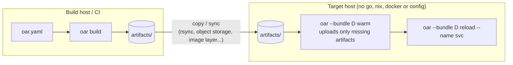

# Operations: switching and distributing runtimes

## Compiled bundles

Every build stores each compiled bundle immutably under `artifacts/manifests/bundles/<digest>.json`.
A bundle digest identifies an environment completely, and a bundle can be started on any host that
has the matching artifacts. The config file, build tools and network are not needed.

```console
$ oar bundles
BUNDLE        PLATFORM     PACKAGES                 COMPONENTS        BUILT
ce402cfd5905  linux/amd64  git,jq,nodejs_22,python313  binary:my-agent  2026-10-19 19:30:16
458248f55e03  linux/amd64  git,nodejs_22,python313     binary:my-agent  2026-10-19 19:30:16

$ oar --bundle 458248f55e03 run --name svc        # full digest or unique prefix
$ oar --bundle ce402cfd5905 reload --name svc     # switch the running service
```

## Distributing precompiled caches



1. Build all candidate configurations once, in CI.
2. Ship `artifacts/`. It is content addressed, so syncing new versions only transfers new tarballs.
3. On the target, pre-warm the next bundle while the current one keeps serving, then `reload`.

Measured on a fresh Linux host with an empty guest cache:

| Step | Time |
|---|---|
| warm a complete bundle (Debian + Node.js + Python + git, 636 MiB) | 1.8 s |
| warm a second bundle that only adds `nix:jq` | 8 ms (3 store paths) |
| first `run` | 150 ms |
| switch with `reload` | ~100 ms |

## Reload strategies

| Strategy | Sequence | Client impact |
|---|---|---|
| `overlap` (default) | start new → wait until ready → stop old | no gap when the service binds with `SO_REUSEPORT` |
| `replace` | create new (not yet exec'd) → stop old → start new → wait until ready | short gap: old exit plus new startup |

```console
$ oar --bundle <digest> reload --name svc                      # overlap
$ oar --bundle <digest> reload --name svc --strategy replace
$ oar --bundle <digest> reload --name svc --stop-timeout 30s   # grace period for the old instance
```

With `overlap`, a new instance that fails its readiness check (or exits) is destroyed and the old
one keeps serving. A bad release therefore never replaces a good one. The retired instance is
cleaned up in the background, so cleanup never delays the next switch.

## Measured switch performance

`hack/switch-bench.sh` alternates a service between two compiled bundles while a prober container
polls it every 5 ms. Results from CI:

| Backend | Strategy | Switch time (CLI, wall) | Failed requests | Longest gap seen by clients |
|---|---|---|---|---|
| Linux native | overlap + SO_REUSEPORT | ~105 ms | 1 of ~990 | 11 ms |
| Linux native | replace | ~100 ms | 29 of ~990 | 33 ms |
| Linux KVM | overlap + SO_REUSEPORT | 130–205 ms | 1 of ~1010 | 12 ms |
| Linux KVM | replace | 127–148 ms | 41 of ~1000 | 50 ms |

Where the time goes, inside the guest, for a typical switch:

| Phase | Time |
|---|---|
| compose (cached template) | ~1 ms |
| overlay mount + config | ~1 ms |
| `runc create` (including one mount per store path) | 40–50 ms |
| `runc start` | ~5 ms |
| readiness (application startup) | ~30 ms |
| stop old instance | ~10 ms |

The single failure under `overlap` is a connection still queued on the old listener when it closes,
a known `SO_REUSEPORT` limitation. Avoiding it requires the application to drain its listener
gracefully.

## Inspecting package evaluation

`oar nix-eval` runs the same evaluation `oar build` runs for `nix:` components and prints what the
build records: output store paths and the main program.

```console
$ oar nix-eval nodejs_22 python313
ATTR       MAIN PROGRAM  OUTPUTS
nodejs_22  node          /nix/store/r8avny0rl4kpc9zig9ar8i9ny7mw0lxz-nodejs-22.23.3
python313  python3.13    /nix/store/jy00n3jp5xj8s40n1fbldmkcr5n7avxc-python3-3.13.15
$ oar nix-eval --system aarch64-linux --json git
$ oar nix-eval --expr 'pkgs.nodejs_22.version'
$ oar nix-eval --nixpkgs ~/src/nixpkgs hello          # a local checkout
$ oar nix-eval --backend local nodejs_22              # the same through nix-instantiate
```

The nixpkgs tree of a revision is downloaded once into the user cache directory
(`~/.cache/oar/nixpkgs/<rev>/` on Linux, `~/Library/Caches/oar/` on macOS; `OAR_CACHE_DIR`
overrides it), next to the evaluator's compiled-file cache. `--backend` picks the embedded evaluator,
`nix-instantiate` on `PATH` or the `nixos/nix` Docker image; `OAR_NIX` sets the default for builds.
Comparing `--backend embedded` with `--backend local` is the quickest way to check the embedded
evaluator against Nix when a package looks wrong.

## Day-to-day commands

| Command | Purpose |
|---|---|
| `oar vm start / stop / status / backends` | manage the resident guest |
| `oar build [--platform ...]` | compile artifacts and bundle locks |
| `oar warm` | pre-load artifacts into the guest cache |
| `oar compose` | compose a bundle and report its digest and timing |
| `oar run` / `oar reload` | start or switch a container |
| `oar ps` / `oar logs [-F]` / `oar exec -- cmd` | inspect |
| `oar stop [--rm]` / `oar rm` | stop and delete |
| `oar digest` / `oar bundles` | inspect compiled bundles |
