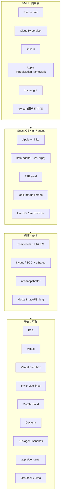
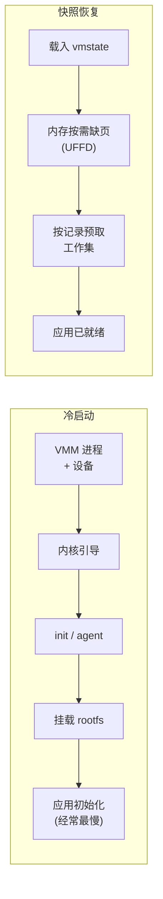

# VM 与沙箱运行时调研报告：业界方案、优化精要与 oar 的改进方向

> 调研时间：2026-10。资料来自各项目的官方文档、源码、工程博客和学术论文。厂商自报的性能数字都注明了出处；没有独立复现的，按「厂商自报」理解。

## 0. 结论速览

1. **隔离方式正在收敛到 microVM。** 数据中心里的托管沙箱基本用 Firecracker 或 Cloud Hypervisor：E2B、Vercel Sandbox、Fly.io、AWS Lambda 用 Firecracker，Modal 的 VM Sandbox 基于 Cloud Hypervisor。本地和桌面场景开始转向 libkrun 和 Apple Virtualization.framework，代表是 Apple Containerization、microsandbox、podman machine。gVisor 适合「兼容性换隔离」的通用沙箱，但 Docker、FUSE、内核特性这类需求最终会把用户推回 VM，Modal 就是这么做的。
2. **快的关键是「不启动」，而不是「启动得快」。** 头部厂商都靠内存快照恢复，而不是冷启动：先在构建期把应用跑到就绪状态再整机快照，运行时用 userfaultfd 按需加载内存页，再按上一次的访问顺序预取。E2B 的模板快照恢复约 80 ms，Unikraft 宣称从快照冷启动只要几十毫秒。
3. **存储正从文件级转向块级、内容寻址、懒加载。** Modal 实测发现，virtio-fs 在元数据密集的场景下慢一个数量级。他们改成在宿主机侧「伪造」一份 ext4 镜像，通过 virtio-blk 按块懒加载，`bun install` 快了约 12 倍。E2B 用 NBD 加分块远端存储加本地 CoW。composefs 和 EROFS 用按内容寻址加 fs-verity，做到磁盘和 page cache 都能共享。
4. **Guest OS 越来越小，宿主机和 guest 之间都是「vsock + RPC」。** Apple 的 `vminitd` 不依赖 libc；Kata 用 Rust agent 加 ttrpc；iii 的 init 只有约 6.4k 行 Rust。设备模型也精简到极致：没有 BIOS、ACPI，没有 PCI，只保留少数几个 virtio 设备。
5. **Nix 和容器的结合有现成先例。** nix-snapshotter 让 containerd 直接按 store path 组装 rootfs，不再受镜像层数上限约束；microvm.nix 把 `/nix/store` 做成 EROFS 只读盘，或者用 virtiofs 共享。这和 oar「按 store path 内容寻址、组合挂载」的思路是一致的。业界的经验是：**把一个闭包做成一块只读镜像（EROFS），比挂载上百个 bind mount 更省开销。**

### 对 oar 最有价值的改进（详见第 6 节）

| 优先级 | 改进 | 解决什么问题 | 参考 |
|---|---|---|---|
| P0 | 每个闭包或产物生成一个 EROFS 只读镜像，作为块设备挂进 guest | warm 时不再解包拷贝；bind mount 数量与闭包大小无关；guest 内 page cache 可以共享 | microvm.nix、composefs、Apple（ext4 块设备）、Modal ImageFS-blk |
| P0 | warm 阶段预先建好 store 视图，并预热 runc 和 overlay 路径 | 消除首次切换偶发几百毫秒的长尾 | E2B 模板快照、K8s agent-sandbox warm pool |
| P1 | 应用级快照：容器就绪后打快照，reload 时直接恢复 | 慢启动应用（Python、Node 冷启动、模型加载）的切换时间从秒级降到百毫秒级 | E2B 模板快照、Modal 内存快照、Lambda SnapStart |
| P1 | Linux 上新增 Cloud Hypervisor 或 Firecracker 后端，取代 QEMU | 启动更快、攻击面更小、原生快照 API | Modal、E2B、Apple（Linux 后端用 CH） |
| P1 | 端口转发（gvisor-tap-vsock，或 libkrun 式的用户态网络栈） | VM 后端里的服务端口能被宿主机访问 | Lima、podman、libkrun |
| P2 | 每个沙箱一个 microVM 的模式，加预热池 | 不可信 agent 之间强隔离 | Apple Containerization、K8s agent-sandbox |
| P2 | 远端分块懒加载 artifacts（Nydus/SOCI 式） | 大闭包分发时「首次可用」更快 | Nydus、SOCI、Modal ImageFS、E2B block |

---

## 1. 调研范围

## 2. 主要开源项目一览

GitHub 数据取自 2026-10-20 的 GitHub API。

| 项目 | ★ | 语言 | 定位 | 与 oar 的关系 |
|---|---|---|---|---|
| [Firecracker](https://github.com/firecracker-microvm/firecracker) | 37.5k | Rust | 极简 microVM VMM（Lambda、Fly、E2B、Vercel 都在用） | 可作为 Linux 后端；快照 + UFFD |
| [Cloud Hypervisor](https://github.com/cloud-hypervisor/cloud-hypervisor) | 6.4k | Rust | 面向云的 VMM，支持 virtio-fs、热插拔、快照 HTTP API | Modal VM Sandbox 和 Apple Linux 后端都选它 |
| [libkrun](https://github.com/libkrun/libkrun) | 2.8k | Rust | 以库形式嵌入的 VMM，KVM 和 macOS HVF 一套 API | macOS 与 Linux 统一后端的候选 |
| [microsandbox](https://github.com/superradcompany/microsandbox) | 8.7k | Rust | 基于 libkrun 的本地优先 microVM 沙箱 | 本地 agent 沙箱的同类产品 |
| [apple/container](https://github.com/apple/container) / [containerization](https://github.com/apple/containerization) | 50.8k / 9.0k | Swift | 每个容器一个轻量 VM、vminitd、gRPC over vsock | 和 oar 的 macOS 路径几乎同构，可直接对照学习 |
| [Kata Containers](https://github.com/kata-containers/kata-containers) | 9.0k | Rust | 每个 Pod 一个 VM；Rust agent + ttrpc；支持 Dragonball/CH/FC | guest agent 与镜像设计的参考 |
| [gVisor](https://github.com/google/gvisor) | 19.7k | Go | 用户态应用内核；支持 checkpoint/restore | Modal 默认运行时；OpenAI Code Interpreter 据报道也用 |
| [Hyperlight](https://github.com/hyperlight-dev/hyperlight) | 4.7k | Rust | 没有 guest 内核的 micro VM，用于函数调用 | 极限冷启动的思路参考 |
| [E2B runtime](https://github.com/e2b-dev/runtime) | 1.7k | Go | E2B 的编排器和 Firecracker 运行时（开源） | 快照、块存储、预取的生产级参考实现 |
| [kubernetes-sigs/agent-sandbox](https://github.com/kubernetes-sigs/agent-sandbox) | 4.3k | Go | 面向 agent 的 Sandbox CRD + warm pool | 预热池与「claim」模型 |
| [microvm.nix](https://github.com/microvm-nix/microvm.nix) | 3.0k | Nix | 声明式 NixOS microVM；store 可做成 EROFS 盘 | Nix store 进 VM 的成熟做法 |
| [nix-snapshotter](https://github.com/pdtpartners/nix-snapshotter) | 0.9k | Go | containerd 直接按 Nix store path 组装 rootfs | 和 oar 的组合思路一致 |
| [composefs](https://github.com/composefs/composefs) | 0.7k | C | EROFS 元数据 + overlay + fs-verity，按内容寻址共享 | 只读产物格式的首选参考 |
| [Nydus](https://github.com/dragonflyoss/nydus) | 1.7k | Rust | 分块、去重、懒加载的镜像格式（FUSE 或 EROFS） | 远端懒加载分发 |
| [SOCI](https://github.com/awslabs/soci-snapshotter) / [stargz](https://github.com/containerd/stargz-snapshotter) | 0.8k / 1.6k | Go | 给 OCI 镜像加索引、懒拉取 | 远端懒加载分发 |
| [Lima](https://github.com/lima-vm/lima) | 22.1k | Go | macOS 上的 Linux VM（VZ/QEMU），containerd/nerdctl | 宿主机–guest 网络与文件共享参考 |
| [LinuxKit](https://github.com/linuxkit/linuxkit) | 8.7k | Go | 用容器拼装极简不可变 OS | guest 镜像构建思路 |
| [Unikraft](https://github.com/unikraft/unikraft) | 3.9k | C | unikernel；云平台支持快照与毫秒级缩容到零 | 极简 guest 的另一条路 |

---

## 3. 代表性方案拆解

### 3.1 Firecracker：极简设备模型 + 快照

- **设计**：只模拟少量必要设备（virtio-net、virtio-block、virtio-vsock、串口等），不模拟 BIOS，直接引导内核。官方口径是从 InstanceStart 到 guest init 约 125 ms，前提是关闭串口、使用最小内核和 rootfs（[LWN](https://lwn.net/Articles/775736)、[SPECIFICATION](https://raw.githubusercontent.com/firecracker-microvm/firecracker/v1.16.1/SPECIFICATION.md)）。第三方指出，这个数字不含 jailer、TAP 创建、rootfs 挂载等宿主机侧准备，冷路径通常还要多 100–300 ms（[particula](https://particula.tech/blog/firecracker-vs-libkrun-boot-time-memory-sizing)）。
- **快照**：快照由两部分组成，一是 vmstate（vCPU 和设备状态的序列化），二是 guest 物理内存的原始转储。恢复时可以用 userfaultfd 把缺页交给用户态进程处理，实现内存懒加载（[官方文档](https://github.com/firecracker-microvm/firecracker/blob/main/docs/snapshotting/handling-page-faults-on-snapshot-resume.md)）。v1.15 起原生支持 UFFD 恢复（[Aquifer 论文](https://arxiv.org/pdf/2606.24079)）。
- **克隆的坑**：同一份内存快照恢复两次就是「克隆」，guest 内核随机数池等状态会重复，必须重新播种（Firecracker 认为重复恢复同一状态是不安全的）。

### 3.2 E2B：模板快照 + 块级懒加载（开源，可读源码）

- **模板构建**：先从模板定义构建容器，提取文件系统，执行 setup，再运行 start 命令、等到就绪，最后**对运行中的沙箱整机快照**。之后每次创建沙箱都从这份快照恢复，约 80 ms，而且进程已经在运行（[模板原理](https://docs.e2b.dev/template/how-it-works.md)）。
- **源码中的关键机制**（[e2b-dev/runtime](https://github.com/e2b-dev/runtime) `packages/orchestrator/pkg/sandbox/`）：
  - `nbd/`：rootfs 以 NBD 块设备的形式交给 Firecracker；
  - `block/streaming_chunk.go`、`cache.go`、`overlay.go`、`dedup.go`：分块远端存储 + 本地缓存 + 写时复制 overlay + 去重；
  - `block/fault.go`、`memfd.go`：内存缺页处理（UFFD）；
  - `block/prefetch_tracker.go`：**记录每个块首次被访问的顺序和类型（读、写、预取）**，下次恢复时按这个顺序预取。这就是学术界 REAP、FaaSnap 一类「记录并重放工作集」的工程化实现。
- **代价**：打快照时沙箱会短暂暂停，所有活跃连接（WebSocket、PTY）都会断开（[snapshots](https://docs.e2b.dev/sandbox/snapshots)）。第三方汇总称暂停约 4 秒/GiB 内存，恢复约 1 秒（[zylos](https://zylos.ai/research/2026-09-23-agent-sandbox-snapshot-restore)）。
- **Guest**：6.1 LTS 内核，guest 内运行 envd 作为 agent。

### 3.3 Modal：gVisor + VM 双运行时，块级 ImageFS

- **gVisor 运行时**（默认）：ImageFS 只预先拉取约 5 MB 的元数据索引，文件内容按内容寻址，按需从多级缓存（本机内存/磁盘、区域 CDN、全局对象存储）获取，并在后台预取。这让启动从约 1 分钟降到 100 ms 以内（[2024 年演讲](https://frontend.modal.com/blog/jono-containers-talk)、[文件系统博客](https://modal.com/blog/vm-sandbox-filesystem)）。在此之上还有 gVisor checkpoint/restore 实现的内存快照（[mem-snapshots](https://modal.com/blog/mem-snapshots)）。
- **为什么又做了 VM 运行时**：agent 越来越需要「像一台真机器」——Docker、数据库、FUSE、GUI、内核特性，这些在 gVisor 里做不到。Modal 基于 Cloud Hypervisor 做了 VM Sandbox，自研了宿主机文件系统、懒加载镜像、内存突发和快照；切换只需一个参数 `runtime="vm"`（[VM sandboxes](https://modal.com/blog/vm-sandboxes-agent-computers)）。
- **最值得学的一课：virtio-fs → 块设备**（[ImageFS-blk](https://modal.com/blog/vm-sandbox-filesystem)）：
  - 最初用 virtio-fs 把 ImageFS 透传给 VM，结果元数据密集的操作极慢：递归 `chown` 从 4 秒变成 1 分钟以上。
  - 改为宿主机守护进程**直接写出 ext4 的 inode 和 extent 元数据**，其余部分保持稀疏，guest 读到哪个块再把它映射回 ImageFS 的文件字节。写入记在稀疏文件里，用脏位图跟踪，相当于 CoW 粒度从「文件」变成「块」。
  - 结果：单次 `chown` 从 99 µs 降到 2.1 µs，`bun install` 从 12.5 s 降到 1.07 s，`ripgrep` 从 6.03 s 降到 0.18 s，pgbench 只读吞吐提升 2.3 倍。

### 3.4 Apple Containerization：每个容器一个 VM（和 oar 的 macOS 路径最接近）

- 每个 Linux 容器跑在自己的轻量 VM 里，宣称亚秒级启动；容器可以有独立 IP，不需要逐个端口转发（[README](https://github.com/apple/containerization)）。
- **vminitd** 是 VM 内的 1 号进程，用 Swift 静态编译（musl），**没有 coreutils、动态库和 libc**；它通过 **gRPC over vsock** 暴露 API，负责挂载、启动进程、转发 I/O、信号和事件（[README](https://github.com/apple/containerization)、[InfoQ](https://www.infoq.com/news/2025/06/apple-container-linux)）。
- **容器文件系统以 ext4 块设备提供**，官方理由是性能（[New Stack](https://thenewstack.io/apple-containers-on-macos-a-technical-comparison-with-docker)）；目录共享按容器隔离。
- 内核配置极简，virtio 驱动必须编进内核而不是做成模块；支持按容器选择内核；建议 6.14.9 以上。用 Rosetta 2 跑 amd64 容器。
- **Linux 后端**用 Cloud Hypervisor，每个 VM 一个进程，块存储走 virtio-blk，共享目录走 virtio-fs，网络走 TAP，宿主机和 guest 之间用 CH 的 hybrid vsock，vminitd 的接口不变。

### 3.5 libkrun / microsandbox：本地 agent 沙箱的新共识

- libkrun 是一个**动态库**（`libkrun.so`/`.dylib`），Linux 上用 KVM、Apple Silicon 上用 Hypervisor.framework，一套 API（[iii 博客](https://iii.dev/blog/why-agent-sandboxes-are-converging-on-libkrun-not-firecracker/)）。
- **它的论点**：Firecracker 依赖 `/dev/kvm`，不能在开发者的 Mac 上跑，而本地编码 agent 恰恰跑在笔记本上。libkrun 是目前唯一能在 Linux 和 macOS 上同时提供接近 Firecracker 隔离的开源 VMM。
- **具体做法**：
  - rootfs 直接用 virtio-fs 共享宿主机目录，不需要 mkfs 和镜像打包；
  - 网络用用户态 smoltcp 协议栈，不需要 root 权限和 TAP 设备；
  - 机器模型精简：没有 PCI、BIOS、ACPI 和 virtio-block；
  - 内核来自 libkrunfw，缓存起来复用；
  - 温启动「几百毫秒」；init 用约 6.4k 行 Rust 写成（作为对比，systemd 约 150 万行，tini 约 1.2 万行）。
- **该文自己承认**：在数据中心里托管沙箱，Firecracker 仍然是正确的选择。

### 3.6 gVisor 的优化（作为用户态内核的参考）

- **rootfs overlay**：容器根文件系统叠一层内存 tmpfs，写入不再经过 gofer。这一层已成为 runsc 的默认配置，abseil 构建的沙箱开销减半（[rootfs overlay](https://gvisor.dev/blog/2023/05/08/rootfs-overlay/)）。
- **directfs**：Sentry（gVisor 的用户态内核）直接访问容器文件系统，不再绕道 gofer。`stat` 快 2 倍以上，真实工作负载耗时降低 12%（[directfs](https://www.gvisor.dev/blog/2023/06/27/directfs/)）。
- 支持 checkpoint/restore，但不能保存宿主机上的 socket（[文档](https://gvisor.dev/docs/user_guide/checkpoint_restore/)）。

### 3.7 其他

| 方案 | 要点 |
|---|---|
| **Kata Containers** | 每个 Pod 一个 VM；kata-agent 用 Rust 写成，通过 ttrpc（比 gRPC 更轻）走 vsock 通信；CH/FC 用 hybrid vsock（宿主机侧是 UNIX socket）；rootfs 走 virtio-fs 或块设备；支持 Nydus rootfs 实现快速启动（[架构](https://github.com/kata-containers/kata-containers)、[hackathon 报道](https://superuser.openinfra.org/articles/the-10th-china-open-source-hackathon-recap-projects-talks-and-more/)） |
| **Hyperlight** | 没有 guest 内核和 OS，直接在 micro VM 里跑函数；演示中每次请求新建 VM，平均 0.9 ms；Hyperlight Wasm 版本为 1–2 ms（[微软博客](https://opensource.microsoft.com/blog/2025/02/11/hyperlight-creating-a-0-0009-second-micro-vm-execution-time/)） |
| **Vercel Sandbox** | 每个沙箱一个 Firecracker microVM，独占内核；从快照恢复比新建更快（[文档](https://vercel.com/docs/vercel-sandbox/concepts)） |
| **Fly.io Machines** | suspend 用的是 Firecracker 快照，恢复约「几百毫秒」，冷启动约 2 s（[zylos 汇总](https://zylos.ai/research/2026-09-23-agent-sandbox-snapshot-restore)） |
| **Unikraft Cloud** | unikernel 跑在 Firecracker 上；应用就绪后打快照再缩容到零，宣称冷启动几十毫秒甚至 <10 ms（厂商自报，[scale-to-zero](https://unikraft.com/blog/scale-to-zero)） |
| **Morph Cloud** | Infinibranch 宣称 <250 ms 完成快照、分支、恢复，内部机制未公开（[文档](https://cloud.morph.so/docs/developers)） |
| **Daytona** | 基于 Docker 容器（共享宿主机内核），宣称冷启动不到 90 ms；隔离强度低于 microVM（[对比文章](https://www.morphllm.com/comparisons/daytona-alternative)，竞品方撰写，请审慎看待） |
| **K8s agent-sandbox** | SIG Apps 项目；提供 Sandbox、SandboxTemplate、SandboxClaim、**SandboxWarmPool** 几种 CRD；隔离交给 gVisor/Kata 的 RuntimeClass；通过 claim 立即拿到一个预热好的沙箱（[K8s 博客](https://kubernetes.io/blog/2026/03/20/running-agents-on-kubernetes-with-agent-sandbox)） |
| **OrbStack** | 多台 Linux 机器共享同一个内核；virtio-fs 加自研动态缓存；用 Rosetta 跑 x86（[架构](https://docs.orbstack.dev/architecture)） |
| **microvm.nix** | 只读根盘可以预先装好 `/nix/store`，格式为 squashfs（更小）或 **erofs（更快）**；也可以用 virtiofs 共享宿主机的 store；Firecracker 不支持目录共享（[README](https://github.com/microvm-nix/microvm.nix)） |
| **nix-snapshotter** | containerd 按 store path 粒度组装 rootfs，没有镜像层数上限（Docker 最多 125 层，大闭包很容易超过），可以和普通层混用，Kubernetes 可以不经镜像仓库运行（[README](https://github.com/pdtpartners/nix-snapshotter)） |
| **composefs** | EROFS 元数据镜像 + overlayfs + fs-verity：文件按内容哈希存储，**磁盘和 page cache 都能跨镜像共享**；整个镜像的 fs-verity 摘要连元数据一起校验；需要 Linux 6.5–6.7 的若干 overlayfs 特性（[README](https://github.com/containers/composefs/blob/main/README.md)、[LWN](https://lwn.net/Articles/917097)） |
| **Nydus / SOCI / eStargz** | 懒拉取镜像格式。有研究表明，拉取镜像占容器启动时间的 76%，但真正被读到的数据只有 6.4%（[FAST'26 CoFS](https://www.usenix.org/system/files/fast26-wang-li.pdf)）；SOCI 不改动原有层，只在旁边加一份索引 |

---

## 4. 优化精要：大家都在做的几件事

### 4.1 启动路径：越短越好，最好不启动

- **精简设备模型**：直接引导内核，不要 BIOS、ACPI、PCI（或尽量少），只用少数几个 virtio 设备；virtio 驱动编进内核，不用模块（Firecracker、libkrun、Apple）。
- **极简 init**：静态编译，不依赖 libc 或 systemd，同时承担 agent 角色（Apple vminitd、kata-agent、E2B envd、iii init）。
- **应用初始化往往才是大头**：冷启动最慢的通常不是内核，而是 Python import、Node 模块加载、JIT、模型加载。所以业界的答案是**在构建期把应用跑到就绪再打快照**（E2B 模板、Lambda SnapStart、Unikraft、Modal 内存快照）。
- **快照恢复的三个要点**：
  1. 内存用 UFFD 或 `MAP_PRIVATE` 按需加载（forkd 报告从一个温父进程派生 100 个子 VM 约 100 ms，靠的是写时复制）；
  2. 按记录的访问顺序预取工作集（E2B 的 prefetch tracker）；
  3. 克隆出来的实例要重新播种随机数（以及处理 vmgenid、时钟、MAC 地址等需要唯一的状态）。

### 4.2 存储：只读、内容寻址、块级、懒加载

| 做法 | 谁在用 | 好处 | 代价 |
|---|---|---|---|
| virtio-fs 共享宿主机目录 | libkrun、Kata、Lima、OrbStack、microvm.nix | 不需要打包，改动立刻可见 | 元数据操作慢（Modal 实测慢一个数量级），需要 virtiofsd |
| **只读块设备（ext4/EROFS）** | Apple、Modal ImageFS-blk、E2B(NBD)、microvm.nix | guest 内是本地文件系统语义，元数据快，可以懒加载、按块 CoW | 需要生成镜像 |
| 内容寻址 + 去重 | composefs、Nydus、Modal、E2B dedup | 跨版本、跨镜像共享磁盘和 page cache | 需要索引和元数据 |
| 懒加载 + 预取 | Modal、E2B、Nydus、SOCI | 首次可用时间与镜像大小基本无关 | 依赖网络或缓存层级，有长尾 |

核心判断：**元数据走本地文件系统，数据按块懒加载、按内容寻址共享。** virtio-fs 适合「开发时共享代码目录」，不适合承载 rootfs 或依赖闭包。

### 4.3 宿主机–guest 通道

- **通道**：普遍用 vsock，上面跑 gRPC（Apple）或 ttrpc（Kata）这类 RPC。Firecracker 和 CH 使用 hybrid vsock，宿主机侧是一个 UNIX socket。libkrun 在 macOS 上 vsock 支持不好，iii 改用 virtio-console 命名端口。
- **原则**：agent 的接口保持小而稳定（iii 只暴露 14 个函数）；接口加版本号；I/O 和信号流式转发。

### 4.4 网络

- 数据中心：TAP + 网桥/NAT（Firecracker、CH），每个沙箱独立 IP（Apple 也是这样）。
- 本地：用用户态协议栈，不需要 root（libkrun 用 smoltcp，Lima/podman 用 gvisor-tap-vsock）；guest 的 loopback 改写到宿主机网关，方便 agent 访问宿主机上的开发服务（iii）。

### 4.5 资源与调度

- **预热池**：K8s agent-sandbox 的 SandboxWarmPool；Fly.io 和 E2B 本质上也是「快照 + 池」。
- **内存突发与回收**：Modal 做了内存突发（memory bursting）；balloon 和 free page reporting 是常见手段。

### 4.6 隔离模型的取舍

| 模型 | 代表 | 隔离 | 兼容性 | 启动 |
|---|---|---|---|---|
| 共享内核容器 | Daytona、runc | 弱 | 最好 | 最快（约 100 ms） |
| 用户态内核 | gVisor（Modal 默认） | 中强 | 中（不支持 Docker/FUSE 等） | 快，可快照 |
| 每沙箱一个 microVM | E2B、Vercel、Fly、Apple、Modal VM | 强 | 好（像一台真机器） | 冷启动 100 ms 以上，快照恢复约 80 ms |
| 无 OS micro VM | Hyperlight | 强 | 只能跑函数或 Wasm | 约 1 ms |

---

## 5. oar 现状对照

| 维度 | 业界做法 | oar 现状 | 差距 |
|---|---|---|---|
| VMM | FC/CH（数据中心），libkrun/VZ（本地） | VZ（macOS）；QEMU/KVM（Linux）；native | Linux 上 QEMU 偏重，没有原生快照 API |
| guest init | 静态编译的 init + vsock RPC | Go 静态 init + 自定义 JSON 协议 over vsock，带版本协商 | ✅ 已对齐 |
| 内核 | 极简配置，virtio 编进内核 | 6.12 LTS，defconfig + 片段，驱动编进内核 | 可以进一步裁剪（PCI/ACPI、virtio-mmio），但收益有限 |
| 隔离粒度 | 每沙箱一个 VM（强）或共享内核 | 一个常驻 VM 内多个 runc 容器 | 没有「每沙箱一个 VM」的强隔离选项 |
| 产物格式 | 只读块镜像（ext4/EROFS），按内容寻址 | 按内容寻址的 tar，warm 时在 guest 里解包到 ext4 | warm 需要解包拷贝；没有 page cache 共享语义；闭包要 N 个 bind mount |
| `/nix/store` 进容器 | 一块只读盘（microvm.nix），或按 path 组装（nix-snapshotter） | 每个 bundle 一个视图（N 个 bind，建一次），容器只 rbind 一次 | ✅ 隔离已对齐；视图首次构建还有长尾 |
| 快照 | 整机或应用快照、UFFD、按记录预取 | 没有 | ❌ 最大的差距：慢启动应用切换受应用初始化时间限制 |
| 懒加载分发 | 分块、按需、多级缓存 | 整份拷贝 artifacts，warm 时只传缺的 | 大闭包首次 warm 仍是全量 |
| 网络 | 独立 IP 或用户态网络栈，支持端口转发 | 容器共享 guest 网络命名空间；VM 后端没有端口转发 | ❌ VM 后端无法从宿主机访问服务 |
| 预热池 | warm pool / claim | 常驻 VM + 产物 warm | 缺少「预先 create 好、未 start 的容器池」 |
| 切换 | 快照 + 原子切换 | overlap/replace + 就绪检查 + 回滚，约 100 ms | ✅ 设计领先，但受限于应用启动时间 |

---

## 6. 建议路线图

> 实施情况：逐项的实测报告见 [docs/benchmarks](../benchmarks/README.md)；完成情况汇总见[第 9 步报告](../benchmarks/09-evaluations/README.md)。

### P0-1：把产物从「tar 解包」改成「只读块镜像」

**做法**：

- 构建期把每个产物（base、每个 store path，或者整个闭包）生成一份 **EROFS 镜像**；用 Go 写一个最小的 EROFS 生成器，或者在 guest 里用 `mkfs.erofs`。
- warm 时只把镜像文件传进 guest 的数据盘，**不再解包**。
- 挂载时用 loop 设备挂 EROFS：base 作为 overlay 的 lowerdir，闭包作为 `/nix/store`。

**收益**：

- warm 从「解包几百 MB 小文件」变成「顺序写几个大文件」，对小文件极多的 Nix 闭包尤其明显；
- **每个闭包一个 EROFS 镜像**：容器的 `/nix/store` 只需一次挂载，不再依赖「建视图 + N 个 bind」，首次切换的长尾也随之消失（microvm.nix 的做法）；
- 只读镜像天然防篡改，以后还可以加 fs-verity（composefs 的做法）。

**注意**：

- 按闭包打镜像会损失跨闭包的文件级去重。可以学 composefs：EROFS 只放元数据，数据放到按内容寻址的对象目录里；或者接受按 store path 粒度做镜像（数量多但仍然可以去重）。
- macOS 上生成镜像需要纯 Go 实现，否则会碰到大小写不敏感的文件系统问题。现有的 NAR→tar 转换已经是纯内存流式处理，可以直接改成写 EROFS。

### P0-2：warm 时预先建好视图，消除首次切换长尾

- 在 `warm` 阶段（或 `compose` 时）就建好 store 视图并缓存 bundle 模板，让「第一次切换到某个 bundle」和后续切换一样快。
- 进一步：为下一个要切换的 bundle 预先 `runc create`（容器已创建但没有 exec），切换时只需 `runc start`。这相当于单机版的 warm pool（参考 K8s agent-sandbox 的 SandboxWarmPool）。

### P1-1：应用级快照（切换收益最大的一项）

在常驻 VM 内对容器做 checkpoint：

- 方案 A：用 CRIU（runc 原生支持 `runc checkpoint/restore`）。构建或首次就绪后打快照，reload 时 `runc restore`。
- 方案 B：「每 bundle 一个 microVM」模式下，直接对 VM 打快照（CH/FC 都有快照 API），恢复时用 UFFD 懒加载，再按 E2B 的方式记录并预取工作集。

**收益**：对需要初始化几秒的 agent（加载模型、编译、Python 冷 import）来说，切换时间会接近恢复时间（典型百毫秒级，具体取决于内存大小和预取效果）。

**风险**：

- CRIU 对 TCP 连接、GPU、部分内核对象支持有限；
- 克隆出来的实例需要重新播种随机数，并处理 UUID 等需要唯一的状态；
- 快照里包含内存内容（密钥等），存储和分发都要考虑加密。

### P1-2：Linux 后端改用 Cloud Hypervisor 或 Firecracker

- **CH** 支持 virtio-fs、热插拔和快照 HTTP API，Modal 和 Apple 都选了它，更适合「常驻 + 快照」。
- **FC** 更极简，适合「每沙箱一个 VM」的高密度场景。

二者都可以复用现有的 guest 内核和 init（需要验证 virtio-mmio 或 PCI 配置）；QEMU 保留为 macOS 兜底和跨架构模拟用。

### P1-3：端口转发与网络

- 本地 VM 后端：引入 gvisor-tap-vsock（Lima/podman 在用）做端口转发，或者参考 libkrun 的用户态协议栈。
- 可选：给每个容器一个独立网络命名空间和 IP（Apple 的模型），从根本上避免端口冲突（这样 overlap 切换就不再依赖 SO_REUSEPORT）。

### P2：其他

- **每沙箱一个 microVM 的强隔离模式**：用于运行不可信 agent。复用同一个 guest 镜像和 agent 协议，按 Apple Containerization 的模型实现，加预热池。
- **远端懒加载分发**：artifacts 按块切分、按内容寻址，guest 侧按需拉取（Nydus/SOCI/Modal ImageFS 的思路），适合大闭包的集群分发。
- **macOS 细节**：用 Rosetta 跑 amd64 guest，加内存 balloon，用 virtio-fs 做开发目录共享（只共享代码，不承载 rootfs）。
- **libkrun 后端评估**：用一套库同时覆盖 macOS（HVF）和 Linux（KVM），作为 VZ 和 QEMU 之外的第三选择。需要注意它不支持 Intel Mac，且 vsock 在 macOS 上支持有限。

### 预期效果（估算，需实测验证）

| 场景 | 现在 | 做完 P0 | 做完 P1 |
|---|---|---|---|
| 首次 warm 一个 600 MB 闭包 | 约 1.8 s（解包） | 预计 <1 s（写几个大文件，受磁盘带宽限制） | 同左 |
| 首次切换到新 bundle | 偶发几百毫秒 | 与后续切换一致（约 100 ms） | 同左 |
| 慢启动应用（初始化 5 s）切换 | ≥5 s | ≥5 s | 预计百毫秒级（快照恢复） |
| 每个容器的挂载数 | 1 + 闭包大小（通过视图） | 2–3（overlay + 闭包 EROFS） | 同左 |

---

## 7. 参考资料

**VMM 与隔离**

- Firecracker：[规格说明](https://raw.githubusercontent.com/firecracker-microvm/firecracker/v1.16.1/SPECIFICATION.md)、[快照缺页处理](https://github.com/firecracker-microvm/firecracker/blob/main/docs/snapshotting/handling-page-faults-on-snapshot-resume.md)、[LWN 介绍](https://lwn.net/Articles/775736)
- [Firecracker vs libkrun 启动时间](https://particula.tech/blog/firecracker-vs-libkrun-boot-time-memory-sizing)
- [为什么 agent 沙箱收敛到 libkrun（iii）](https://iii.dev/blog/why-agent-sandboxes-are-converging-on-libkrun-not-firecracker/)
- [Hyperlight](https://opensource.microsoft.com/blog/2025/02/11/hyperlight-creating-a-0-0009-second-micro-vm-execution-time/)
- gVisor：[rootfs overlay](https://gvisor.dev/blog/2023/05/08/rootfs-overlay/)、[directfs](https://www.gvisor.dev/blog/2023/06/27/directfs/)、[checkpoint/restore](https://gvisor.dev/docs/user_guide/checkpoint_restore/)
- Kata：[architecture](https://github.com/pkuliuliu/kata-containers/blob/main/docs/design/architecture.md)、[OpenInfra hackathon](https://superuser.openinfra.org/articles/the-10th-china-open-source-hackathon-recap-projects-talks-and-more/)
- [Aquifer：基于 CXL/RDMA 的 microVM 快照内存池](https://arxiv.org/pdf/2606.24079)

**平台**

- E2B：[模板原理](https://docs.e2b.dev/template/how-it-works.md)、[快照](https://docs.e2b.dev/sandbox/snapshots)、[源码](https://github.com/e2b-dev/runtime)
- Modal：[VM Sandboxes](https://modal.com/blog/vm-sandboxes-agent-computers)、[ImageFS-blk](https://modal.com/blog/vm-sandbox-filesystem)、[内存快照](https://modal.com/blog/mem-snapshots)、[2024 年容器演讲](https://frontend.modal.com/blog/jono-containers-talk)
- Apple：[containerization](https://github.com/apple/containerization)、[InfoQ](https://www.infoq.com/news/2025/06/apple-container-linux)、[The New Stack](https://thenewstack.io/apple-containers-on-macos-a-technical-comparison-with-docker)
- [Vercel Sandbox](https://vercel.com/docs/vercel-sandbox/concepts)、[Morph Cloud](https://cloud.morph.so/docs/developers)、[Unikraft scale-to-zero](https://unikraft.com/blog/scale-to-zero)
- [Agent 沙箱快照能力汇总（zylos）](https://zylos.ai/research/2026-09-23-agent-sandbox-snapshot-restore)
- [Daytona 对比（morphllm）](https://www.morphllm.com/comparisons/daytona-alternative)
- [K8s Agent Sandbox](https://kubernetes.io/blog/2026/03/20/running-agents-on-kubernetes-with-agent-sandbox)、[文档](https://agent-sandbox.sigs.k8s.io/docs/getting_started/overview/)
- [OrbStack 架构](https://docs.orbstack.dev/architecture)

**镜像与存储**

- composefs：[README](https://github.com/containers/composefs/blob/main/README.md)、[LWN](https://lwn.net/Articles/917097)、[FOSDEM 2024](https://archive.fosdem.org/2024/events/attachments/fosdem-2024-3250-composefs-and-containers/slides/22189/ComposeFS_fosdem_pb16gQM.pdf)
- [Nydus](https://pkg.go.dev/github.com/dragonflyoss/nydus)、[FAST'26 CoFS 论文](https://www.usenix.org/system/files/fast26-wang-li.pdf)、[为什么 SOCI 应该在构建期生成（Depot）](https://depot.dev/blog/why-soci-belongs-in-the-build.md)
- [nix-snapshotter](https://github.com/pdtpartners/nix-snapshotter)、[Nix 与分层 Docker 镜像（grahamc）](https://grahamc.com/blog/nix-and-layered-docker-images)
- [microvm.nix](https://github.com/microvm-nix/microvm.nix)

**本地文件与预取实现**

- [forkd](https://p.codekk.com/detail/rust/deeplethe/forkd)、[Wrenn（Firecracker → Cloud Hypervisor 迁移）](https://git.omukk.dev/wrenn/sandbox/src/branch/dev/internal/vm/fc.go)
- [Linux 缺页、mmap 与 userfaultfd](https://www.shayon.dev/post/2026/65/linux-page-faults-mmap-and-userfaultfd)
